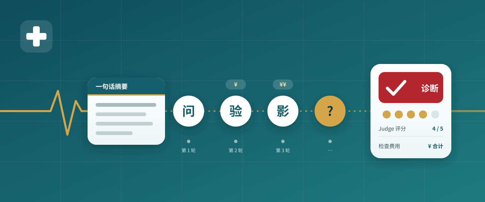
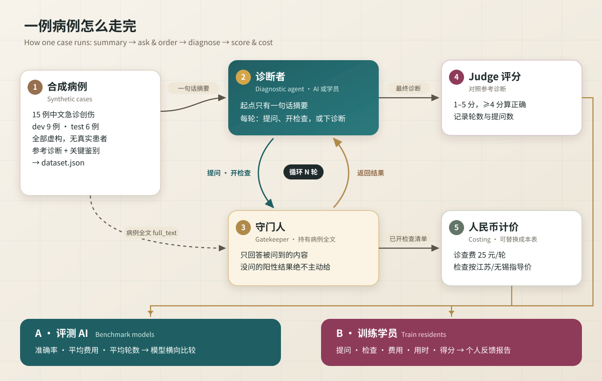

<p align="center">
  
</p>

<h1 align="center">急诊创伤序贯诊断基准 · ED Trauma SDBench-CN</h1>

<p align="center">
  <strong>只给一句话，边问边查，看谁诊断得又准又省</strong><br>
  Start from one sentence, ask and order step by step, and see who gets it right at the lowest cost
</p>

<p align="center">
  基于微软 SDBench 的中文急诊创伤病例集：同一套病例既能评测 AI，也能训练住院医和医学生。<br>
  A Chinese emergency-trauma case set on Microsoft SDBench, for benchmarking models and training residents.
</p>

<p align="center">
  <a href="README.md">简体中文</a> · <a href="docs/english-readmev0.1.md">English</a>
</p>

<p align="center">
  <a href="cases/v0.1/"></a>
  <a href="costing/cost-sourcesv0.1.md"></a>
  <a href="#pilot"></a>
  <a href="LICENSE"></a>
</p>

<p align="center">
  <code>全部虚构病例</code> · <code>SDBench 官方加载器验证</code> · <code>江苏/无锡公开价格</code> · <code>逐项可追溯来源</code> · <code>学员反馈报告</code>
</p>

<p align="center">
  <a href="#use-cases">使用场景</a> ｜ <a href="#workflow">怎么走</a> ｜ <a href="#cases">病例清单</a> ｜ <a href="#quick-start">快速开始</a> ｜ <a href="#costing">计价口径</a> ｜ <a href="#capabilities">能力状态</a> ｜ <a href="#contribute">参与共创</a>
</p>

<p align="center"><sub>封面与流程图为本仓库原创 SVG 示意图，不是真实截图。本项目与微软 SDBench 官方没有隶属关系。</sub></p>

> ⚠️ **仅限研究与教学，不是医疗器械，不用于临床诊断或决策。** 微软已就 SDBench 评测框架申请美国专利（US Patent Application No. 19/722,651），涉及商业用途请自行评估相关权利。
> For research and education only. Microsoft has filed a US patent application (No. 19/722,651) covering the SDBench evaluation framework.

---

<a id="use-cases"></a>

## 用在哪里 · Use cases

| 你想做什么 | 可以怎样开始 |
| --- | --- |
| 看大模型在中文创伤场景下会不会"乱开检查" | 用 SDBench 原版 harness 跑 `ed-trauma-cn`，再用人民币成本表计价 |
| 带教住院医做序贯诊断训练 | 学员只拿到一句话摘要，逐轮提问、开检查，最后下诊断，自动出反馈报告 |
| 比较学员与模型 | 同一病例、同一守门人、同一计价规则，准确率和费用放在一起看 |
| 换成本院价格 | 复制成本表，改价格和来源，一条命令重新计价 |

<a id="workflow"></a>

## 一例病例怎么走 · Workflow

<p align="center">
  
</p>

[SDBench](https://github.com/microsoft/sdbench)（Nori et al., *Sequential diagnosis with language models*, Science 2026;394(6822):423-428, doi:10.1126/science.aeh7930）把诊断变成"边问边查"：诊断者只看到一句话摘要，向守门人（Gatekeeper）提问、开检查，最后下诊断，由 Judge 按 1–5 分评分（≥4 分算正确），同时统计检查费用。

<a id="cases"></a>

## 病例清单 · Cases

| 编号 | 主题 | 参考诊断（简） | 难度 | 病例集 |
| --- | --- | --- | --- | --- |
| ETC-01 | 骨盆骨折出血 | 不稳定型骨盆环骨折伴活动性出血 | 中 | dev |
| ETC-02 | 张力性气胸 | 右侧张力性气胸伴多发肋骨骨折 | 易 | dev |
| ETC-03 | 心包填塞 | 胸部穿透伤致右心室破裂、急性心包填塞 | 中 | dev |
| ETC-04 | 钝性主动脉损伤 | 钝性胸主动脉损伤 | 难 | dev |
| ETC-05 | 以创伤为表现的非创伤急症 | 急性 Stanford A 型主动脉夹层 | 难 | test |
| ETC-06 | 脾破裂 | 迟发性脾破裂 | 中 | dev |
| ETC-07 | 颅脑外伤 | 急性硬膜外血肿 | 易 | dev |
| ETC-08 | 老年抗凝颅脑外伤 | 利伐沙班相关急性硬膜下血肿 | 中 | test |
| ETC-09 | 挤压综合征 | 横纹肌溶解、高钾血症 | 中 | dev |
| ETC-10 | 脂肪栓塞综合征 | 股骨干骨折后脂肪栓塞综合征 | 中 | dev |
| ETC-11 | 腹腔间隔室综合征 | 腹腔间隔室综合征 | 难 | test |
| ETC-12 | 老年髋部骨折合并隐匿问题 | 股骨颈骨折，跌倒原因为三度房室传导阻滞 | 中 | test |
| ETC-13 | 多发伤隐匿空腔脏器损伤 | 钝性小肠穿孔（安全带综合征） | 难 | test |
| ETC-14 | 钝性脑血管损伤 | 钝性左颈内动脉夹层 | 难 | test |
| ETC-15 | 膈肌破裂 | 创伤性左侧膈肌破裂伴胃、结肠疝入胸腔 | 中 | dev |

<sub>病例依据 ATLS 及 WSES、EAST、BTF、WSACS、ESC/ACC-AHA 等指南编写，文献见每例 `guideline_refs`。全部为作者虚构，不含任何真实患者信息。</sub>

<a id="quick-start"></a>

## 先用起来 · Quick start

```bash
uv sync                                                    # 安装依赖
uv run python scripts/build-datasetv0.1.py                 # 病例 Markdown → dataset.json
SDBENCH_DATA_PATH=./data uv run python -m sdbench.cli.case_data ed-trauma-cn --list-only

# 跑 AI 评测：本地 .env 填 OPENROUTER_API_KEY（不要提交），关闭上游美元计价
SDBENCH_DATA_PATH=./data uv run python -m sdbench.cli.harness \
  --dataset ed-trauma-cn --case-set dev --agent baseline --model <openrouter-model-slug> \
  --sdbench-config science --no-compute-costs --max-workers 4

uv run python scripts/cn-costingv0.1.py results/<run>/json                       # 人民币计价
uv run python scripts/teaching-reportv0.1.py results/<run>/json/case_k0_ETC-01.json --out report.md   # 反馈报告
```

<sub>`dataset.json`、`case_k*_*.json` 是 SDBench 要求的固定文件名，不受本项目"文件名不用下划线"的约定约束。</sub>

<a id="costing"></a>

## 计价口径 · Costing

**每轮诊查费 25 元 + 已开检查按江苏/无锡公开指导价计价 → 待核实或未匹配的不估价，单独列出**

| 想知道的事 | 本项目的做法 |
| --- | --- |
| 价格从哪来 | 无锡市医保局价格文件（影像、超声、检验）与苏州市公立医院价格目录，逐项附文件号与生效日期 |
| 算了什么 | 只算**诊断性检查的医疗服务项目费**，与 SDBench 原设计一致 |
| 没算什么 | 对比剂、耗材、药品、血制品、抢救/监护费、治疗性操作（如胸腔闭式引流、DSA 栓塞） |
| 怎样换价格 | 复制 `costing/cn-cost-sheetv0.1.csv`，改价格与来源，加 `--sheet` 重新计价 |

> **注意：** 这里的费用是"诊断检查费"，**不是抢救室实际账单**。以骨盆 APC-III 骨折为例，真实抢救室费用常达数千至上万元，主要来自血制品、对比剂、耗材和介入治疗，均不在本口径内。全口径计价计划在后续版本加入。

详见 [成本表来源](costing/cost-sourcesv0.1.md)。

<a id="capabilities"></a>

## 当前做到哪一步 · Capability status

| 状态 | 内容 | 实际边界 |
| --- | --- | --- |
| 已完成 · 已验证 | 15 例合成病例 → `dataset.json` | 通过 SDBench 官方加载器；病例尚未经同行审校 |
| 已完成 | 中文成本表 58 项 | 39 项已核实，18 项待核实，留空不估价 |
| 已完成 | 人民币计价脚本、学员反馈报告脚本 | 报告示例为虚构会话 |
| <a id="pilot"></a>试点 · 非官方 | 用 Hark 自带模型跑 15 例 | 15/15 命中主要诊断，均分 4.87，平均 ¥700.6/例；简化守门人脚本、作者本人评分，不可与论文结果比较，见 [`examples/pilot-runv0.1/`](examples/pilot-runv0.1/) |
| 已知问题 | 病例偏易 | "体格检查"一次返回全部关键体征，下一版拆成按系统返回 |
| 计划中 | 交互式学员终端、班级汇总、抢救室全口径计价、OpenRouter 官方基线 | — |

<a id="contribute"></a>

## 一起把它做得更好 · Contribute

欢迎急诊、创伤、ICU 同行审校病例、补充本院价格，或贡献新病例（儿童创伤、烧伤、中毒等）。

| 你想了解什么 | 从这里进入 |
| --- | --- |
| 病例原文 | [`cases/v0.1/`](cases/v0.1/) |
| 成本表与来源 | [成本表](costing/cn-cost-sheetv0.1.csv) · [来源说明](costing/cost-sourcesv0.1.md) |
| 教学模式设计 | [设计稿](docs/teaching-mode-designv0.1.md) · [示例报告](examples/demo-reportv0.1.md) |
| English overview | [English homepage](docs/english-readmev0.1.md) |
| 建议或问题 | [GitHub Issues](https://github.com/TUANZIDING/ed-trauma-sdbench-cn/issues) |

<details>
<summary><strong>数据许可与引用 / Data licensing and citation</strong></summary>

NEJM 病例需 NEJM 非商业许可，MIMIC 子集（PhysioNet MIMIC-IV-Ext-SDBench）需认证并签 DUA，均不得放入本仓库（已在 `.gitignore` 中排除）。本仓库只包含作者原创的合成病例。

使用本项目请同时引用：Nori H, et al. Sequential diagnosis with language models. *Science*. 2026;394(6822):423-428. doi:10.1126/science.aeh7930

</details>

---

<p align="center">
  <strong>急诊创伤序贯诊断基准 · ED Trauma SDBench-CN</strong><br>
  少开一张单子，也要先想清楚为什么开。<br>
  <a href="https://github.com/TUANZIDING">TUANZIDING</a> · 丁海祥 Haixiang Ding, MD · Emergency and Trauma Surgeon
</p>

<sub>本仓库原创病例、文档、SVG 与脚本采用 MIT 许可，并保留 Microsoft SDBench 原版权声明（见 <a href="LICENSE">LICENSE</a>）。SDBench 为 Microsoft 的 MIT 开源项目。</sub>
