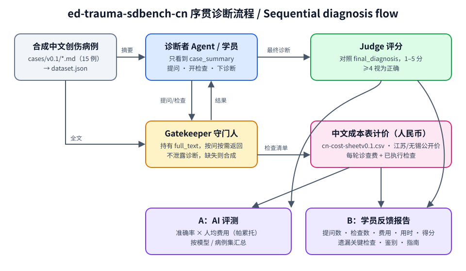

# ed-trauma-sdbench-cn

**中文急诊创伤序贯诊断基准与教学工具（v0.1）**
*A Chinese emergency-trauma sequential-diagnosis benchmark and teaching kit, built on Microsoft SDBench.*

> ⚠️ **仅限研究与教学使用 / For research and education only.** 本项目不是医疗器械，不用于临床诊断或决策。
> 微软已就 SDBench 评测框架申请美国专利（US Patent Application No. 19/722,651）；使用者如涉及商业用途，请自行评估相关权利。
> Microsoft has filed a US patent application (No. 19/722,651) covering the SDBench evaluation framework; this repository is provided for non-commercial research and teaching.



## 这是什么 / What it is

[SDBench](https://github.com/microsoft/sdbench)（Nori et al., *Sequential diagnosis with language models*, Science 2026;394(6822):423-428, doi:10.1126/science.aeh7930）
把诊断变成一个"边问边查"的过程：诊断者只看到一句话摘要，需要向守门人（Gatekeeper）提问、开检查，最后下诊断，由 Judge 评分，并统计检查费用。

本项目把这套框架搬到**中文急诊创伤场景**，并做到 **A + B 合一**：

- **A：评测 AI** —— 用 SDBench 原版 harness 跑模型，看准确率和人民币费用。
- **B：训练人** —— 住院医 / 医学生走同样的流程，生成个人反馈报告（提问数、检查数、费用、用时、得分、遗漏的关键检查）。

## v0.1 内容 / What's in v0.1

| 部分 | 文件 | 说明 |
|---|---|---|
| 合成病例 15 例 | `cases/v0.1/*.md` | 全部虚构；YAML 头含参考诊断、关键鉴别、关键线索、指南依据 |
| SDBench 数据集 | `data/processed_case_data/ed-trauma-cn/dataset.json` | 由脚本生成，已用 SDBench 官方加载器验证（dev 9 / test 6） |
| 教学元数据 | `data/processed_case_data/ed-trauma-cn/case-metav0.1.json` | 关键检查、鉴别、线索、指南 |
| 中文成本表 | `costing/cn-cost-sheetv0.1.csv` | 58 项，江苏/无锡公开价格，逐项附来源，查不到的标「待核实」 |
| 成本表来源 | `costing/cost-sourcesv0.1.md` | 文件号、生效日期、计价规则、待核实清单 |
| 构建脚本 | `scripts/build-datasetv0.1.py` | Markdown 病例 → dataset.json，含字段与"摘要不泄露诊断"校验 |
| 人民币计价 | `scripts/cn-costingv0.1.py` | 离线给 SDBench 结果计价，可换成本表 |
| 反馈报告 | `scripts/teaching-reportv0.1.py` | 会话 JSON → 中文反馈报告 |
| 教学设计稿 | `docs/teaching-mode-designv0.1.md` | 流程、记录字段、报告结构、后续计划 |
| 示例 | `examples/demo-*v0.1.*` | 虚构会话与对应报告，仅演示格式 |

## 病例清单 / Cases

| 编号 | 主题 | 参考诊断（简） | 难度 | 病例集 |
|---|---|---|---|---|
| ETC-01 | 骨盆骨折出血 | 不稳定型骨盆环骨折 | 中 | dev |
| ETC-02 | 张力性气胸 | 右侧张力性气胸伴右侧多发肋骨骨折 | 易 | dev |
| ETC-03 | 心包填塞 | 胸部穿透伤致右心室破裂、急性心包填塞 | 中 | dev |
| ETC-04 | 钝性主动脉损伤 | 钝性胸主动脉损伤 | 难 | dev |
| ETC-05 | 主动脉夹层（以创伤为表现的非创伤性急症） | 急性 Stanford A 型主动脉夹层 | 难 | test |
| ETC-06 | 脾破裂 | 迟发性脾破裂 | 中 | dev |
| ETC-07 | 颅脑外伤 | 急性硬膜外血肿 | 易 | dev |
| ETC-08 | 颅脑外伤（老年抗凝） | 抗凝 | 中 | test |
| ETC-09 | 挤压综合征 | 挤压综合征：右下肢挤压伤所致横纹肌溶解、高钾血症 | 中 | dev |
| ETC-10 | 脂肪栓塞综合征 | 脂肪栓塞综合征 | 中 | dev |
| ETC-11 | 腹腔间隔室综合征 | 继发性腹腔间隔室综合征 | 难 | test |
| ETC-12 | 老年髋部骨折合并隐匿问题 | 左股骨颈骨折 | 中 | test |
| ETC-13 | 空腔脏器损伤（多发伤隐匿损伤） | 钝性小肠穿孔 | 难 | test |
| ETC-14 | 颅脑/颈部外伤（钝性脑血管损伤） | 钝性左颈内动脉夹层 | 难 | test |
| ETC-15 | 膈肌破裂（多发伤隐匿损伤） | 创伤性左侧膈肌破裂伴胃及结肠脾曲疝入胸腔 | 中 | dev |

病例依据 ATLS 以及 WSES、EAST、BTF、WSACS、ESC/ACC-AHA 等指南编写，具体文献见每例 `guideline_refs`。
所有病例均为作者虚构，**不含任何真实患者信息**。

## 快速开始 / Quick start

```bash
# 1. 安装依赖（uv）
uv sync

# 2. 生成 / 校验数据集
uv run python scripts/build-datasetv0.1.py

# 3. 用 SDBench 官方加载器检查
SDBENCH_DATA_PATH=./data uv run python -m sdbench.cli.case_data ed-trauma-cn --list-only

# 4. 配置模型 key：复制 .env.example 为 .env，本地填写 OPENROUTER_API_KEY（不要提交）
cp .env.example .env

# 5. 跑 AI 评测（关闭上游美元计价，改用中文成本表）
SDBENCH_DATA_PATH=./data uv run python -m sdbench.cli.harness \
  --dataset ed-trauma-cn --case-set dev --agent baseline --model <openrouter-model-slug> \
  --sdbench-config science --no-compute-costs --max-workers 4

# 6. 人民币计价
uv run python scripts/cn-costingv0.1.py results/<run>/json

# 7. 生成某一例的反馈报告（AI 结果或学员会话均可）
uv run python scripts/teaching-reportv0.1.py results/<run>/json/case_k0_ETC-01.json --out report.md
```

> 注：`dataset.json`、`case_k*_*.json` 是 SDBench 加载器/输出要求的固定文件名，不受本项目"文件名不用下划线"的约定约束。

## 计价方式 / Costing

上游 SDBench 用美国 Kaiser 医院 chargemaster + CPT 匹配（美元）。本项目改为：

- 每一轮计一次急诊诊查费 25 元（替代每轮 300 美元）；
- 每个已执行检查按别名匹配 `cn-cost-sheetv0.1.csv`，CT/MRI 按部位、CTA 按血管计价；
- 待核实或无法匹配的检查**不估价**，单独列出。

详见 [`costing/cost-sourcesv0.1.md`](costing/cost-sourcesv0.1.md)。

## 数据许可提醒 / Data licensing

- NEJM 病例需 NEJM 非商业许可，MIMIC 子集（PhysioNet MIMIC-IV-Ext-SDBench）需认证并签 DUA，**均不得放入本仓库**（已在 `.gitignore` 中排除）。
- 本仓库只包含作者原创的合成病例。

## 路线图 / Roadmap

- v0.2：交互式学员终端（LLM 守门人 / 教师守门人）、班级汇总报告、学员与模型同图比较。
- 补全「待核实」价格；增加儿童创伤、烧伤、中毒等病例；邀请同行审校病例。
- 中文 Gatekeeper / Judge prompt 适配与一致性评估。

## 引用 / Citation

如使用本项目，请同时引用 SDBench 原论文：
Nori H, et al. Sequential diagnosis with language models. *Science*. 2026;394(6822):423-428. doi:10.1126/science.aeh7930

## 许可 / License

MIT（见 [LICENSE](LICENSE)），并保留 Microsoft SDBench 原版权声明。
